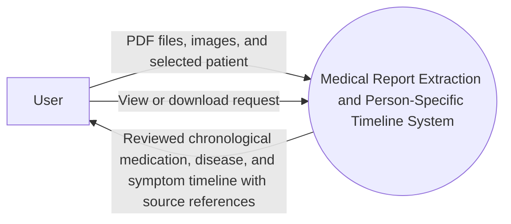
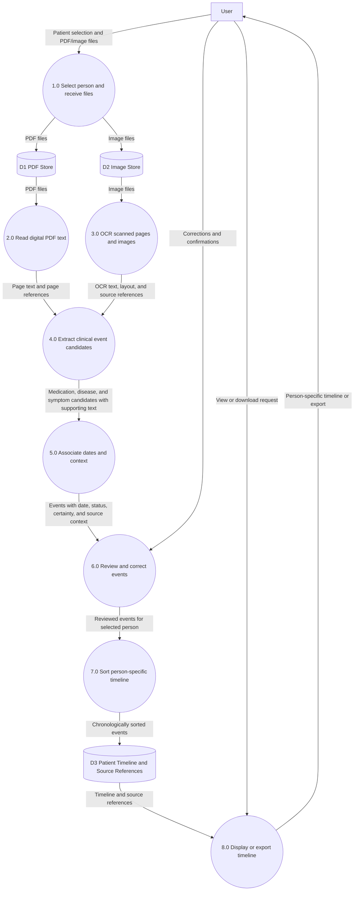

# Medical Timeline Extractor

## Project aim

Build an application that accepts medical report PDFs and images, extracts medication, disease, and symptom mentions for a selected person, associates each mention with a date when the report supports one, and displays the information as a chronological timeline.

The application presents extracted information for review. It does not diagnose conditions, recommend treatment, or replace the original medical report.

## Level 0 DFD — Context Diagram

**External entity:** User

**Main process:** Medical Report Extraction and Person-Specific Timeline System

**Data flows:**

- **User → System:** PDF files and image files for processing.
- **User → System:** Selected patient profile and view or download request.
- **System → User:** Extracted medication, disease, and symptom events arranged chronologically, with source references for review.



## Level 1 DFD



## Data stores

- **D1 — PDF Store:** Uploaded PDF reports, retained as required for processing and source review.
- **D2 — Image Store:** Uploaded image files, retained as required for processing and source review.
- **D3 — Patient Timeline and Source References:** Reviewed events, dates, patient association, supporting text, and references to the originating report and page.

## Processes

1. **Select person and receive files:** The user selects or creates an application-specific patient profile and uploads PDF or image reports. The application should not infer patient identity from report text in the first version.
2. **Read digital PDF text:** Extract text page by page from PDFs that contain selectable text.
3. **OCR scanned pages and images:** Recognize text in image files and scanned PDF pages, retaining the filename and page number.
4. **Extract clinical event candidates:** Identify possible medication, disease, and symptom mentions and preserve the exact supporting passage.
5. **Associate dates and context:** Find dates and capture context such as current or historical, started or stopped, confirmed or uncertain, negated or present, and patient or family member.
6. **Review and correct events:** Let the user inspect the source passage and confirm, reject, or edit extracted events and dates.
7. **Sort person-specific timeline:** Sort reviewed events by the event date. Keep undated events in a separate section. Sorting is performed by application code.
8. **Display or export timeline:** Present the selected person's reviewed timeline and allow export, for example to CSV.

## Event data fields

Store each extracted event with fields such as:

```text
patient_id
source_document_id
event_type              medication | disease | symptom
event_name
normalized_event_date
original_date_text
date_meaning             onset | prescription | report | unknown
status                   current | started | stopped | historical | unknown
certainty                confirmed | suspected | uncertain
negation                 present | absent | not stated
experiencer              patient | family member | other | unknown
source_filename
source_page
supporting_text
extraction_method        rules | OCR | model | user-entered
review_status            needs review | confirmed | corrected | rejected
```

A report date is not necessarily the date a symptom began or a medication was started. Preserve the date's meaning when the report makes it clear, and leave it unknown when it does not.

## Suggested technology

- **Python and Streamlit:** Local web interface, upload, review, and download.
- **PyMuPDF:** Digital PDF text extraction and page-level processing.
- **PaddleOCR:** OCR for image uploads and scanned PDF pages.
- **medspaCy:** Clinical text processing components, including section detection and contextual rules for negation or uncertainty.
- **SQLite:** Local storage for patient profiles, source documents, and reviewed timeline events.
- **Pandas:** Tabular review and CSV export.
- **Optional Hugging Face model:** A clinical named-entity recognition model can propose medication, disease, and symptom spans. Check the model card for its labels, limitations, license, and hardware needs before choosing it. Model output should remain a candidate for user review.

## Step-by-step implementation plan

### 1. Set up the project

In PowerShell:

```powershell
mkdir medical-timeline
cd medical-timeline
py -m venv .venv
.venv\Scripts\Activate.ps1
```

Create this initial structure:

```text
medical-timeline/
├── app.py                         # Streamlit entry point and user interface
├── database.py                    # SQLite setup and database operations
├── config.py                      # App settings and storage paths
├── requirements.txt               # Python dependencies
├── .gitignore                     # Excludes local data, uploads, and secrets
├── models/
│   └── event.py                   # Timeline event data structure
├── extractors/
│   ├── pdf_reader.py              # Digital PDF extraction and page rendering
│   └── image_reader.py            # PaddleOCR for images and scanned pages
├── processing/
│   ├── clinical_events.py         # Medication, disease, and symptom candidates
│   ├── dates.py                   # Date detection and normalization
│   └── timeline.py                # Review filtering and chronological ordering
├── services/
│   ├── ingestion.py               # Coordinates upload and extraction pipeline
│   └── export.py                  # CSV generation
└── data/                           # Local runtime data; do not commit
    ├── medical_timeline.db        # SQLite database created by the app
    └── uploads/                   # Optional temporary uploaded files
```

The `models`, `extractors`, `processing`, and `services` directories contain application code. The `data` directory is created at runtime for local records and temporary files; exclude it from version control. For a first prototype, it is fine to keep the event data structure in `database.py` and add `models/event.py` as the project grows.

### 2. Install the basic packages

Create `requirements.txt`:

```text
streamlit
pymupdf
pillow
pandas
python-dateutil
medspacy
```

Install the packages:

```powershell
python -m pip install -r requirements.txt
```

Install PaddleOCR separately using its current platform-specific instructions. CPU and GPU installation steps differ.

### 3. Build the upload and patient-selection screen

In `app.py`, add:

- A patient profile selector or application-specific patient ID field.
- A multi-file uploader for PDF, PNG, and JPG files.
- A process button.
- A review table and a timeline display area.
- A CSV download button.

Associate every uploaded report and resulting event with the selected patient ID. Do not automatically merge people based only on matching names.

### 4. Extract PDF text page by page

In `extractors/pdf_reader.py`:

1. Open the PDF.
2. Extract text from each page.
3. Record the filename and page number with the text.
4. Mark pages with little or no selectable text for OCR.

### 5. OCR images and scanned pages

In `extractors/image_reader.py`:

1. Pass image files and marked PDF pages to PaddleOCR.
2. Collect recognized text and layout information where available.
3. Preserve the filename and page number.
4. Keep OCR output as a draft because recognition errors can alter drug names and dates.

### 6. Extract event candidates

In `processing/clinical_events.py`:

1. Split the extracted text into sentences or passages.
2. Identify candidate medication, disease, and symptom mentions using clinical rules, terminology lists, and optionally a clinical NER model.
3. Save the supporting sentence and source reference for every candidate.
4. Capture whether each mention is negated, uncertain, historical, or refers to someone other than the selected patient.

Examples of context that must be preserved:

- “No evidence of pneumonia” is not a confirmed pneumonia event.
- “Possible migraine” is uncertain.
- “Mother had diabetes” belongs to a family member, not automatically to the patient.
- “Previously took…” should not automatically be treated as a current medication.

### 7. Associate and normalize dates

In `processing/dates.py`:

1. Find date mentions near each event.
2. Store the original wording and a normalized date when possible.
3. Distinguish an event date from the report date when the text supports that distinction.
4. Flag ambiguous dates, such as `03/04/2024`, for user review.
5. Leave the event date unknown rather than guessing when the report does not provide enough information.

### 8. Add the human review step

Display candidates in an editable table with date, event type, event name, status, certainty, source document, page, and supporting text. Let the user confirm, reject, or correct each candidate before it is saved to the timeline.

### 9. Store reviewed events

In `database.py`, use SQLite tables for patient profiles, source documents, and events. Store the fields listed above, including the source text and review status.

### 10. Build the timeline and export

In `processing/timeline.py`:

1. Filter events for the selected patient.
2. Sort reviewed events by normalized event date, oldest to newest.
3. Show events without a date separately.
4. Preserve multiple events on the same date.
5. Display source references so the user can return to the report.

Add CSV export for the reviewed timeline. Include patient ID, event date, event type, event name, status, certainty, source filename, page, and supporting text.

### 11. Run the app

Start it from the project folder:

```powershell
streamlit run app.py
```

Begin with synthetic or properly de-identified reports. Confirm that a digital PDF, scanned PDF, and image each retain their source references and that the user can correct extracted events before saving or exporting.

## Privacy and intended use

Medical reports contain sensitive personal information. During development, use synthetic or properly de-identified files. Run OCR and NLP locally when possible; do not send real reports to a public demo or hosted model endpoint unless its data handling and access terms have been reviewed for the intended use.

Present the output as information extracted from reports for review—not as a diagnosis, treatment recommendation, or complete medical record. Users must be able to inspect the original report because OCR and NLP can miss or misinterpret clinical information.

